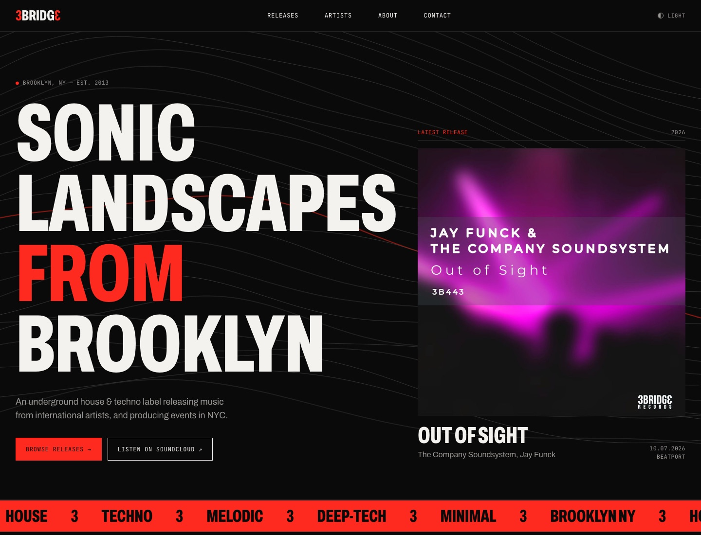
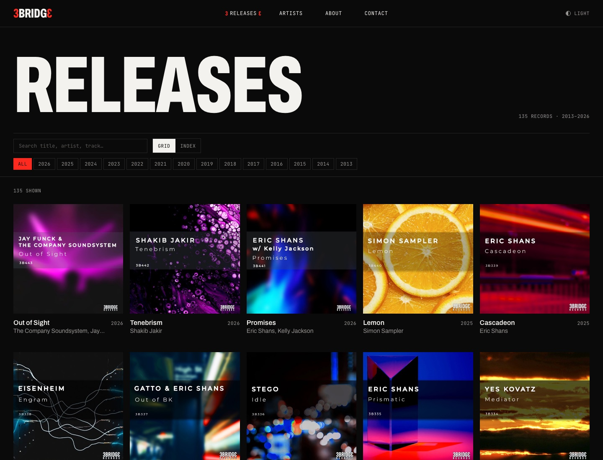
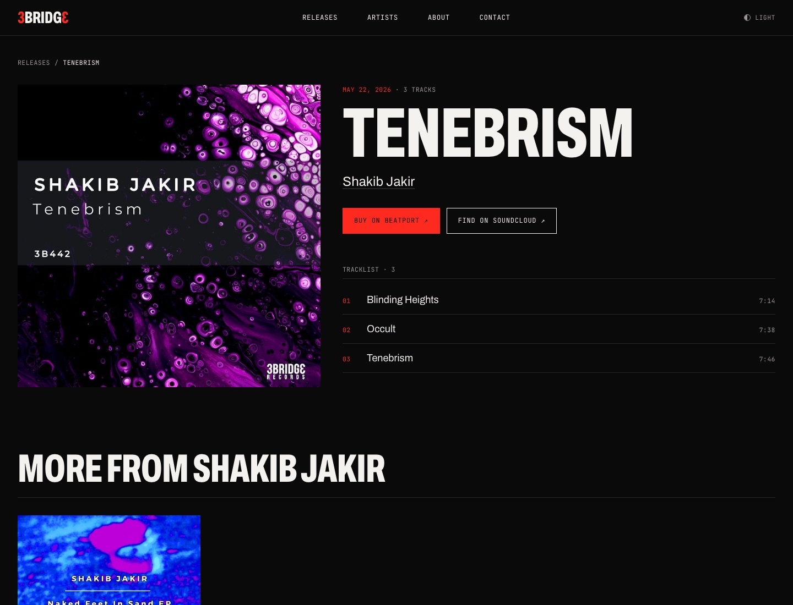
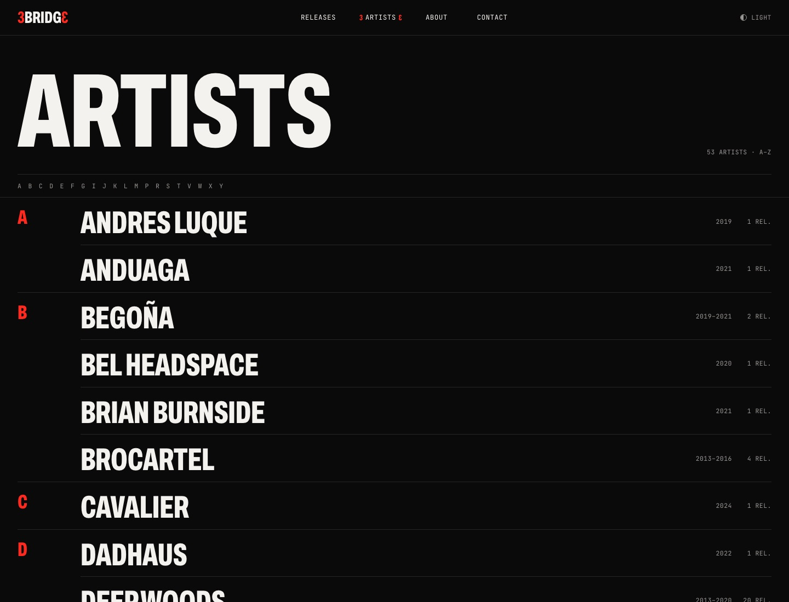

# 3Bridge Records

A ground-up rebuild of [3bridgerecords.com](https://www.3bridgerecords.com), the site for a Brooklyn house & techno label, moving it from a decade-old WordPress theme to a fast, static Nuxt site.

**Live preview:** https://3bridge-records.pages.dev



## What's in it

- **135 releases and 53 artists**, migrated from the old WordPress site and kept current from Deezer's public API
- **Releases catalog** with grid and index views, year filters, search across titles, artists and tracks, and shareable filtered URLs (`?view=index&year=2019`)
- **Release and artist pages** with tracklists, notes, store links, discographies and `MusicAlbum` structured data
- **Dark and light themes**, set before first paint (no flash)
- **Old URLs preserved** (`/release/<slug>`, `/artist/<slug>`) so existing links and search rankings keep working
- Fully **static**: 390+ prerendered pages, hosted free on Cloudflare Pages

| Releases | Release | Artists |
|---|---|---|
|  |  |  |

## Design

Built around the label's logo, a red **3**, **BRIDG** and a mirrored red **Ɛ**:

- Black, white and logo red, with a warm-paper light theme
- **Archivo** variable font, condensed to `wdth 62` for display type that echoes the logo; **JetBrains Mono** for metadata
- The mirrored "3" doubles as a bracket around active nav links
- Generated contour-line "sonic landscapes" (deterministic SVG) and a genre marquee instead of stock video

## Stack

[Nuxt 4](https://nuxt.com) · Vue 3 · TypeScript · Tailwind CSS 4 · Cloudflare Pages

## Structure

```
site/       Nuxt app (pages, components, content JSON, images)
scripts/    Migration and import tools
docs/       Screenshots
```

### Migration scripts

| Script | What it does |
|---|---|
| `scripts/fetch_uploads.py` | Downloads original media from the WordPress uploads directory (skips auto-generated resized copies) |
| `scripts/mirror_site.py` | Saves a polite, same-domain copy of the site's pages |
| `scripts/extract_content.py` | Parses the saved theme HTML into `releases.json` / `artists.json` and resizes images |
| `scripts/import_deezer.py` | Adds new label releases (cover, date, tracklist) from Deezer by album ID, without overwriting edits |

## Running locally

```sh
cd site
npm install
npm run dev        # http://localhost:3000
npm run generate   # static build -> .output/public
```

See [site/README.md](site/README.md) for content editing.

---

Music, artwork and artist content © 3Bridge Records and the respective artists.
